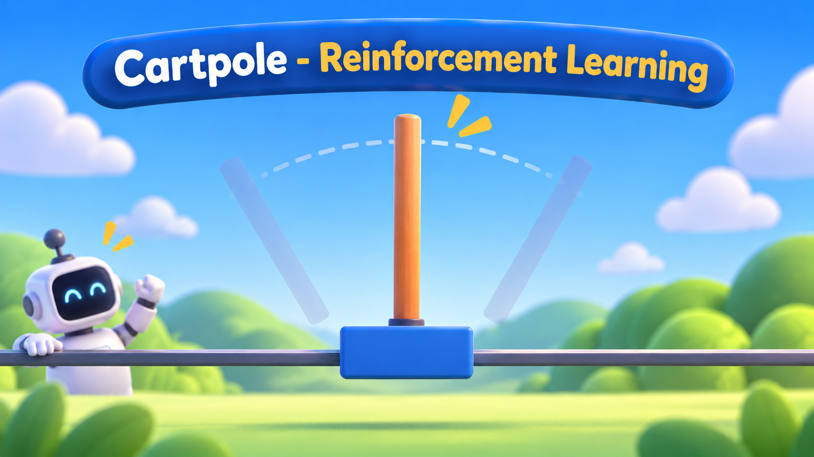
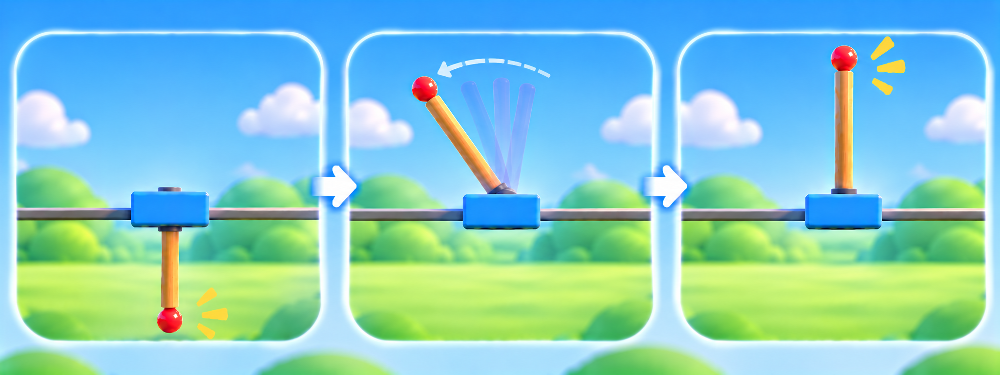
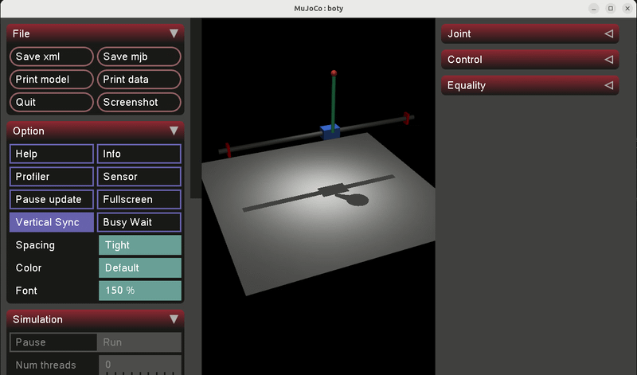

<div align="center">
  <p align="center">
    
  </p>
</div>

<div style="display: flex; justify-content: center; gap: 10px;">
  <p>
    
  </p>
  <p>
    
  </p>
  <p>
    
  </p>
  <p>
    
  </p>
</div>

---

## About The Project

`CARTPOLE` is a reinforcement learning project that teaches an agent to swing a pole up from its hanging position and keep it balanced upright, by moving a cart along a rail. It is designed from the ground up as a clean, structured and reusable foundation for training robot controllers in simulation and taking them to real hardware.

<div align="center">
  
</div>

The cart-pole is a small problem, but it already contains everything that makes robot learning hard, a part that cannot be driven directly, a motor with limited strength, a rail that ends, sensors that are never perfect, and a real robot that never quite behaves like its simulation.

<div align="center">
  <p align="center">
    
  </p>
</div>

Rather than being a one-off training script, `CARTPOLE` is built using real-world software engineering practices. It features an environment that talks to the robot only through an interface, so the same code runs on the MuJoCo simulation and on a real robot. Randomizations and disturbances plug in through registries, every setting lives in a configuration file, and the documentation covers each part. Together, these provide a **robust foundation for anyone looking to build, study, or extend a sim-to-real reinforcement learning pipeline.**

---

## Documentation

> [!IMPORTANT]
>
> `CARTPOLE DOCUMENTATION`: https://cartpole-rl.netlify.app/
>

<div align="center">
  <p align="center">
    
  </p>
</div>

---

### Development

To contribute, install the development tools (Ruff, Pyright, pre-commit) and enable the git hooks:

```bash
pip install -e ".[dev]"
pre-commit install            # format and check on every commit
pre-commit run --all-files    # run all checks once on the whole repo
```
